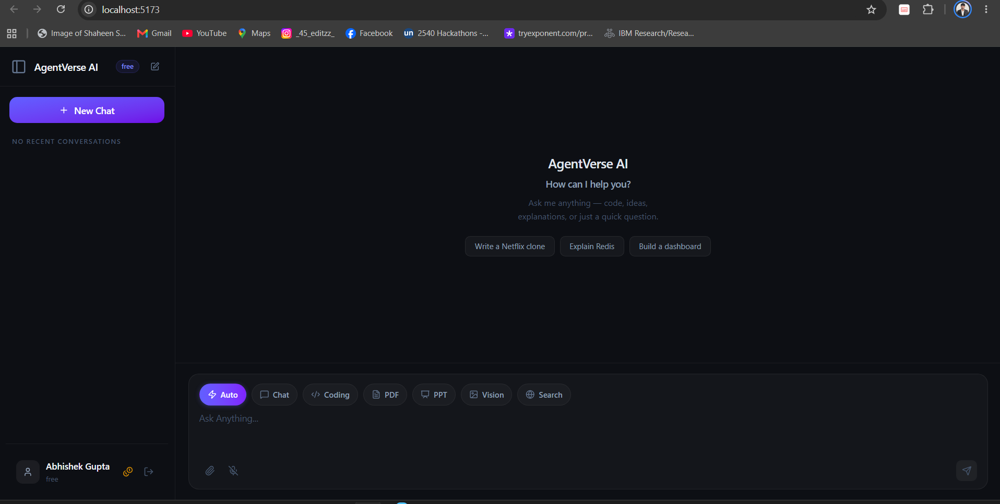
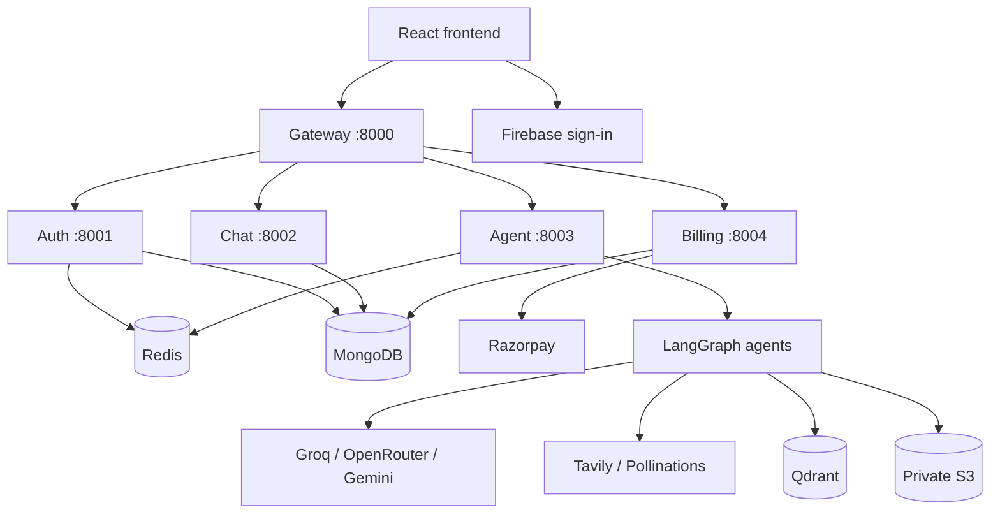

# AgentVerse AI

A multi-agent AI workspace for conversations, coding, web research, document understanding, image generation, and presentations. A React interface connects to five Node.js services, with LangGraph routing requests to specialized agents.

[Environment setup](ENVIRONMENT.md) | [AWS deployment](AWS_DEPLOYMENT.md) | [S3 setup](backend/services/agent/S3_SETUP.md)

## Application preview

The interface includes a conversation sidebar, Google sign-in, file attachments, credit balance, and Auto, Chat, Coding, PDF, PPT, Vision, and Search modes.



## Features

- **Chat:** context-aware conversations, saved history, Markdown, syntax highlighting, and current date/time context.
- **Automatic routing:** LangGraph selects an agent; uploaded PDFs and images take precedence over ordinary chat routing.
- **Coding:** programming answers and generated multi-file projects with Monaco viewing and sandboxed previews.
- **PDF understanding:** text extraction, retrieval for long documents, and Gemini document vision for scanned or sparse PDFs.
- **Document generation:** downloadable PDF reports and PowerPoint presentations.
- **Vision:** image analysis and Pollinations image generation.
- **Search:** Tavily web research and verified existing images accompanying educational answers.
- **Storage:** generated files and selected search images stored in private S3 and delivered through signed URLs.
- **Authentication:** Firebase Google sign-in, server-side token verification, and Redis-backed cookie sessions.
- **Billing:** Razorpay credit-pack checkout, verified payments, and usage-based deductions.

Features require valid credentials, available services, and provider quota. Free application credits do not guarantee free provider or AWS usage.

## Important technologies

| Area | Technologies |
| --- | --- |
| Frontend | React 19, Vite 8, Tailwind CSS 4, Redux Toolkit, Axios, Motion, Lucide |
| Content display | React Markdown, remark-gfm, syntax highlighting, Monaco Editor |
| Backend | Node.js, Express 5, ES modules, Multer, microservices/API gateway |
| AI orchestration | LangChain, LangGraph |
| Models | Groq `openai/gpt-oss-120b`, OpenRouter `openrouter/free`, Gemini `gemini-2.5-flash` |
| Search/images | Tavily, Pollinations |
| Documents | pdf-parse, PDFKit, PptxGenJS, Gemini document vision |
| Data | MongoDB/Mongoose, Redis/ioredis, Qdrant, Google embeddings |
| Identity/payments | Firebase Authentication/Admin SDK, Razorpay |
| Storage | AWS S3, AWS SDK signed URLs |
| Deployment | Docker, Docker Compose, CloudFormation, ECS Fargate, ECR, CloudFront, ElastiCache, Secrets Manager, GitHub Actions/OIDC |

Model names reflect current code configuration; provider availability and limits can change.

## Architecture



Firebase returns an ID token, which the auth service verifies before creating a Redis session. The gateway checks that session before forwarding protected requests. Production backend calls also require a shared internal service token.

## Project structure

```text
agentverse-ai/
  frontend/                 React application
  backend/
    gateway/                Public API entry point
    services/
      auth/                 Login, sessions, users, credits
      chat/                 Conversations and messages
      agent/                AI agents, retrieval, files, S3
      billing/              Razorpay orders and verification
    shared/                 Redis, auth, health, plans, credits
    docker-compose.yml      Local Redis only
  deployment/               Validation and AWS scripts/templates
  .github/workflows/        Checks and AWS deployment
  ENVIRONMENT.md            Environment configuration
  AWS_DEPLOYMENT.md         Complete AWS deployment guide
```

## Local setup

### 1. Prerequisites

- Node.js 24 and npm, matching the deployment containers.
- Git and Docker Desktop with its Linux engine running.
- MongoDB Atlas or local MongoDB. Payment credit grants require transaction support, such as Atlas or a local replica set.
- Qdrant Cloud or local Qdrant for vector retrieval.
- Credentials for the integrations listed below.

### 2. Get the source

```powershell
git clone https://github.com/guptaabhishek2265/Codex_ai_multi_model.git
cd Codex_ai_multi_model/agentverse-ai
```

If already downloaded, open the existing `agentverse-ai` directory. Run the following commands from that repository directory.

### 3. Install dependencies

Install backend root dependencies too; shared modules use its Redis package.

```powershell
$folders = @('backend', 'backend/gateway', 'backend/services/auth', 'backend/services/chat', 'backend/services/agent', 'backend/services/billing', 'frontend')
foreach ($folder in $folders) {
    Push-Location $folder
    npm.cmd ci
    if ($LASTEXITCODE -ne 0) { Pop-Location; throw "Install failed in $folder" }
    Pop-Location
}
```

### 4. Configure environment files

Each application loads its own `.env`. This copies templates only when `.env` is missing and preserves existing configuration:

```powershell
$folders = @('frontend', 'backend/gateway', 'backend/services/auth', 'backend/services/chat', 'backend/services/agent', 'backend/services/billing')
foreach ($folder in $folders) {
    if (-not (Test-Path "$folder/.env")) {
        Copy-Item "$folder/.env.example" "$folder/.env"
    }
}
```

Fill the files using [ENVIRONMENT.md](ENVIRONMENT.md). `.env.example` alone is not runtime configuration.

| Configuration | Location |
| --- | --- |
| Firebase public web configuration | Frontend `.env`: `VITE_FIREBASE_*` |
| Firebase Admin private JSON | `backend/services/auth/serviceAccountKey.json` or `FIREBASE_SERVICE_ACCOUNT_JSON` |
| MongoDB URI | Auth, chat, agent, billing `.env` |
| Redis URL | Gateway, auth, agent `.env` |
| Groq, OpenRouter, Google AI, Tavily keys | Agent `.env` |
| Qdrant URL and cloud key | Agent `.env` |
| Pollinations secret key | Agent `.env` |
| S3 region, bucket, local credentials or supported credential chain | Agent `.env` |
| Razorpay key ID and secret | Billing `.env` |
| Matching Razorpay public key ID | Frontend `.env`: `VITE_RAZORPAY_KEY_ID` |

Enable **Google** in Firebase Authentication and authorize `localhost`. The web configuration and Admin JSON must belong to the same Firebase project. Keep Razorpay in test mode during development.

The agent initializes several provider clients at startup: supply Groq, OpenRouter, Google AI, and Tavily keys even when initially trying only one mode. Keep private keys on the backend; `VITE_*` values are bundled into the browser application.

### 5. Start Redis

Open Docker Desktop and wait for its Linux engine to run:

```powershell
docker compose -f backend/docker-compose.yml up -d
docker compose -f backend/docker-compose.yml exec -T redis redis-cli ping
```

The check should return `PONG`. Compose currently starts **only Redis**. MongoDB and Qdrant must also be reachable at the configured URLs.

### 6. Start the application

Open six separate terminals at the repository root. Run one row in each terminal and keep it running:

| Process | Commands | Default port |
| --- | --- | --- |
| Auth | `cd backend/services/auth` then `npm.cmd run dev` | 8001 |
| Chat | `cd backend/services/chat` then `npm.cmd run dev` | 8002 |
| Agent | `cd backend/services/agent` then `npm.cmd run dev` | 8003 |
| Billing | `cd backend/services/billing` then `npm.cmd run dev` | 8004 |
| Gateway | `cd backend/gateway` then `npm.cmd run dev` | 8000 |
| Frontend | `cd frontend` then `npm.cmd run dev` | 5173 |

Open **http://localhost:5173** and choose **Continue With Google**. Keep `localhost` consistent across frontend/gateway settings. Restart services after changing `.env`, including Vite for frontend changes.

### 7. Try the application

- Chat: `Explain what an ecosystem is.`
- Coding: `Write binary search in JavaScript.`
- PDF reading: attach a PDF and ask `Summarize this document.`
- PDF/PPT generation: select the corresponding mode and request a report or presentation.
- Vision: attach an image and ask a question about it.
- Search: ask for information requiring web research.
- Image generation: request a generated image with Pollinations and S3 configured.

## Credits and billing

The implementation uses credit packs, not automatically recurring subscriptions.

| Plan | Price (INR) | Credits | Configured validity |
| --- | --- | --- | --- |
| Free | 0 | 100 | 30 days |
| Starter | 199 | 500 | 30 days |
| Pro | 499 | 1,000 | 30 days |

Configured operation costs: chat **1**, search **5**, coding/PDF/PPT/vision/image **10** credits each. Workflows combining operations can incur multiple deductions. Source values are in `backend/shared/plans.js` and `backend/shared/credits.js`.

Billing checks the Razorpay signature and payment details before an idempotent credit grant. Keep frontend/backend key IDs matched. Test checkout does not collect real payments.

## Validation and build

From the repository root:

```powershell
node deployment/validate.mjs
npm.cmd --prefix frontend run build
```

Validation checks backend/deployment JavaScript syntax and runs repository tests. The frontend build writes `frontend/dist`. CI also checks CloudFormation templates.

## AWS deployment

Use [AWS_DEPLOYMENT.md](AWS_DEPLOYMENT.md) for the complete sequence, commands, credentials, verification, updates, and cleanup.

The repository includes Docker images and infrastructure preparation for five ECS Fargate services, ECR, private S3/CloudFront frontend hosting, ALB, VPC/NAT, ElastiCache Redis, Secrets Manager, task roles, CloudWatch, and GitHub Actions OIDC deployment. The templates do not deploy themselves.

**AWS infrastructure incurs charges.** The starter configuration has one task per service, one Redis node, and one NAT gateway. CloudFront-to-ALB uses HTTP with a secret origin header; configure origin HTTPS or a VPC origin before sensitive production use. Long requests have a 120-second CloudFront response window. Automated payment webhook reconciliation is not included.

## Troubleshooting

| Problem | Action |
| --- | --- |
| `dockerDesktopLinuxEngine` pipe missing | Start Docker Desktop, wait for its Linux engine, retry Compose. |
| Missing `dotenv` package | Run `npm.cmd ci` in the affected service and install backend root dependencies. |
| Missing Groq/Razorpay key | Fill the service's actual `.env`, run from that directory, restart. |
| Google login fails | Check enabled provider, authorized localhost, matching Admin project, running auth/gateway, browser popup errors. |
| MongoDB connection fails | Check password encoding, Atlas IP allowlist, database user permissions, connectivity. |
| PDF cannot be explained | Confirm attachment selection; scanned documents require working Google AI document vision. |
| Images/downloads fail | Check provider credentials, S3 region/permissions, and signed URL expiry; retain private bucket access. |
| Payment needs verification | Use billing verification retry and inspect billing/auth logs. |
| PowerShell blocks `npm.ps1` | Use `npm.cmd` as shown above. |

Stop each app with `Ctrl+C`. Stop local Redis from the repository root:

```powershell
docker compose -f backend/docker-compose.yml down
```

## Security and contributions

Actual `.env` files, Firebase Admin JSON, and deployment private files are ignored by Git. Never commit them or place backend secrets in frontend code. Rotate exposed credentials, use task IAM roles on AWS, and retain S3 Block Public Access.

Create a branch for changes, describe the behavior being changed, run relevant checks, and preserve existing license attribution.

## License

See [LICENSE](LICENSE) for the repository's MIT license and attribution.
